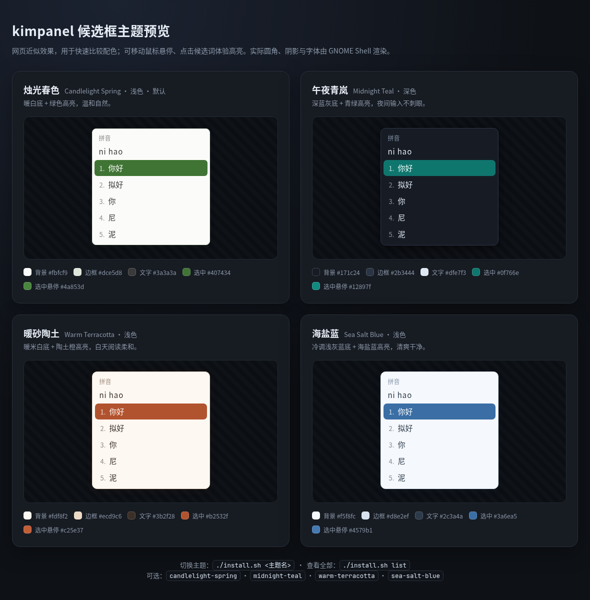

# GNOME kimpanel 候选框主题集

为 [Input Method Panel（kimpanel）](https://extensions.gnome.org/extension/261/kimpanel/) GNOME 扩展准备的候选框主题，适用于 GNOME Shell + fcitx5（rime）。 / Candidate window themes for GNOME Shell's Input Method Panel (kimpanel) with fcitx5/rime.

四套开箱即用的配色，纯 CSS、无额外依赖，一条命令即可切换：

- 支持横向 / 纵向候选列表
- 不修改 fcitx5 或 rime 配置
- 不需要 root 权限
- 已在 Debian 13 + GNOME Shell 48 + Wayland 下测试

## 主题一览

3 套 light 风格，1 套 dark 风格

| 主题 | 风格 | 选中项 |
|------|------|--------|
| **Candlelight Spring**（烛光春色） | 暖白底 + 绿色高亮（默认） | `#407434` |
| **Midnight Teal**（午夜青岚） | 深蓝灰底 + 青绿高亮，适合夜间 | `#0f766e` |
| **Warm Terracotta**（暖砂陶土） | 暖米白底 + 陶土橙高亮，温暖柔和 | `#b2532f` |
| **Sea Salt Blue**（海盐蓝） | 冷调浅灰蓝底 + 海盐蓝高亮，清爽干净 | `#3a6ea5` |

四套主题使用同一套 CSS 结构，主要差别在配色；其余三套主题的圆角与内边距比 Candlelight Spring 略大一点。

## 效果预览



用浏览器打开 [`preview.html`](./preview.html) 可以查看可交互预览。

## 快速开始

### 依赖

- GNOME Shell（在 48 下测试，扩展 v92 支持 48–50）
- [Input Method Panel（kimpanel）](https://extensions.gnome.org/extension/261/kimpanel/) 扩展
- fcitx5，推荐搭配 fcitx5-rime；其他 fcitx5 输入法同样适用

### 安装

```bash
git clone https://github.com/hellodk34/gnome-kimpanel-themes.git
cd gnome-kimpanel-themes

# 安装默认主题（烛光春色）
./install.sh

# 查看所有主题
./install.sh list
```

> 如果提示 `Permission denied`，先执行 `chmod +x install.sh`。

`install.sh` 会依次：

1. 停用 kimpanel 扩展；
2. 把 `themes/<主题名>.css` 复制为扩展目录下的 `stylesheet.css`；
3. 注册 GSettings schema（用于调整字体和竖排）；
4. 重新启用扩展。

切换后立即生效；如果样式没有变化，注销并重新登录即可（Wayland 下最可靠）。

### 切换主题

```bash
# 白天：暖砂陶土
./install.sh warm-terracotta

# 夜间：午夜青岚
./install.sh midnight-teal

# 清爽冷调：海盐蓝
./install.sh sea-salt-blue

# 回到默认：烛光春色
./install.sh candlelight-spring
```

### 手动安装（不用脚本）

1. 把 `themes/` 下对应主题的 `.css` 文件复制到 `~/.local/share/gnome-shell/extensions/kimpanel@kde.org/`；
2. 重命名为 `stylesheet.css`（覆盖原文件，建议先备份原文件）；
3. 注销并重新登录。

> 文件管理器里按 `Ctrl+H` 可以显示隐藏目录。

## 纵向候选列表

候选框方向由 **kimpanel 扩展**控制，不是 fcitx5 的「经典用户界面」设置。

在 fcitx5 的「附加组件 → 经典用户界面」里勾选「垂直候选列表」不会生效，因为 kimpanel 的 `UIPriority` 更高，候选框实际由 GNOME Shell 渲染，Classic UI 的布局选项不参与。

正确的打开方式：

**图形界面**

```bash
gnome-extensions prefs kimpanel@kde.org
```

打开 **Vertical List**（垂直列表）。

**命令行**

```bash
# 开启纵向候选
gsettings set org.gnome.shell.extensions.kimpanel vertical true

# 恢复横向候选
gsettings set org.gnome.shell.extensions.kimpanel vertical false
```

修改后立即生效，不需要注销。

## 字体

字体不由此仓库控制，而是由 GSettings 的 `font` 键动态注入内联样式（优先级高于 `stylesheet.css`）。`install.sh` 会注册 schema，之后可以用 `gsettings` 调整：

```bash
# 查看当前字体
gsettings get org.gnome.shell.extensions.kimpanel font

# 推荐字体
gsettings set org.gnome.shell.extensions.kimpanel font 'Noto Sans CJK SC 14'
```

主题文件中虽然写了 `font-family: "Sans"`，但实际字体会被上面的内联样式覆盖。

## 常见问题

### 候选框样式完全没有变化

1. 确保扩展正确安装且已启用；
2. 确认安装的是本仓库的完整主题，而不是只改了 `preview.html`；
3. 重新执行 `./install.sh <主题名>`；
4. 注销并重新登录，确保 GNOME Shell 重新读取样式表。

### 候选高亮被其他扩展覆盖

kimpanel 的候选项使用 `.kimpanel-candidate-item` 样式类。如果安装了其他输入法美化扩展，它可能通过 `!important` 强制改色。可以检查并禁用冲突扩展：

```bash
gnome-extensions list --enabled
```

### 为什么 fcitx5 的主题不生效

fcitx5 有两个 UI 模块竞争渲染候选框：

| 模块 | 优先级 | 作用 |
|------|--------|------|
| kimpanel | `UIPriority=50` | 通过 DBus 把候选词交给 GNOME Shell 渲染 |
| classicui | `UIPriority=0`（默认） | fcitx5 自行渲染，使用 `classicui.conf` 中的主题 |

kimpanel 优先级更高，所以候选窗口实际由 GNOME Shell 的 `stylesheet.css` 控制，而不是 fcitx5 的主题配置。这也是本仓库只覆盖 `stylesheet.css`、不需要修改 fcitx5-rime 配置的原因。

## 自定义与贡献

新增一套主题：

```bash
cp themes/candlelight-spring.css themes/my-theme.css
# 编辑 themes/my-theme.css 中的颜色
./install.sh my-theme
```

主要样式类：

| 选择器 | 作用 |
|--------|------|
| `.kimpanel-popup-content` | 候选框主体（背景、边框、圆角、阴影） |
| `.kimpanel-label` | 预编辑、辅助码等文字 |
| `.kimpanel-candidate-item` | 单个候选项 |
| `.kimpanel-candidate-item:hover` | 鼠标悬停 |
| `.kimpanel-candidate-item:active` | 当前选中项 |

最常修改的值：

- 选中项：`.kimpanel-candidate-item:active` 的 `background-color`
- 悬停：`.kimpanel-candidate-item:hover` 的 `background-color`
- 候选框底色 / 边框 / 阴影：`.popup-menu-content.kimpanel-popup-content`
- 圆角：`border-radius`（内容区与候选项建议保持 10px / 7px 的比例）

欢迎提交 PR 增加主题；如果能附带 `preview.html` 中的预览卡片和截图就更好了。

## 文件结构

| 文件 | 用途 |
|------|------|
| `themes/candlelight-spring.css` | 烛光春色（默认绿色主题） |
| `themes/midnight-teal.css` | 午夜青岚（深色 + 青绿） |
| `themes/warm-terracotta.css` | 暖砂陶土（浅色 + 陶土橙） |
| `themes/sea-salt-blue.css` | 海盐蓝（浅色 + 冷调蓝） |
| `stylesheet.css` | 默认主题副本，方便手动安装 |
| `preview.html` | 四套主题的网页预览 |
| `preview.png` | 四套主题的预览截图 |
| `org.gnome.shell.extensions.kimpanel.gschema.xml` | kimpanel 的 GSettings schema（font / vertical 键） |
| `install.sh` | 一键安装 / 切换主题 |

## 致谢

- 感谢 [gnome-kimpanel-mac-theme](https://github.com/chalmery/gnome-kimpanel-mac-theme) 提供的启发和初始主题
- 感谢 [gnome-shell-extension-kimpanel](https://github.com/wengxt/gnome-shell-extension-kimpanel) 提供 GNOME 下的 kimpanel 实现

## License

[MIT](LICENSE)
